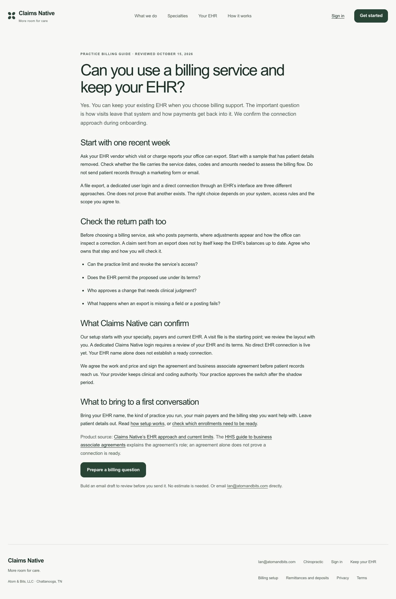
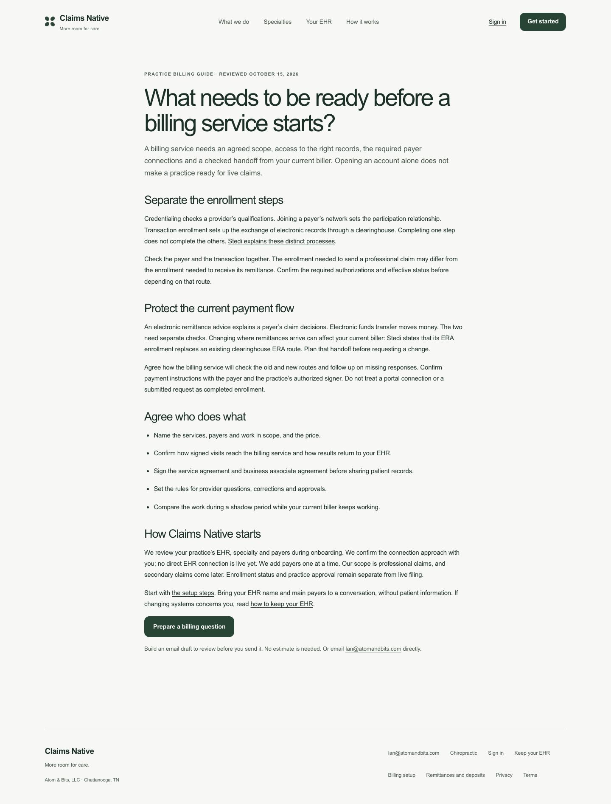
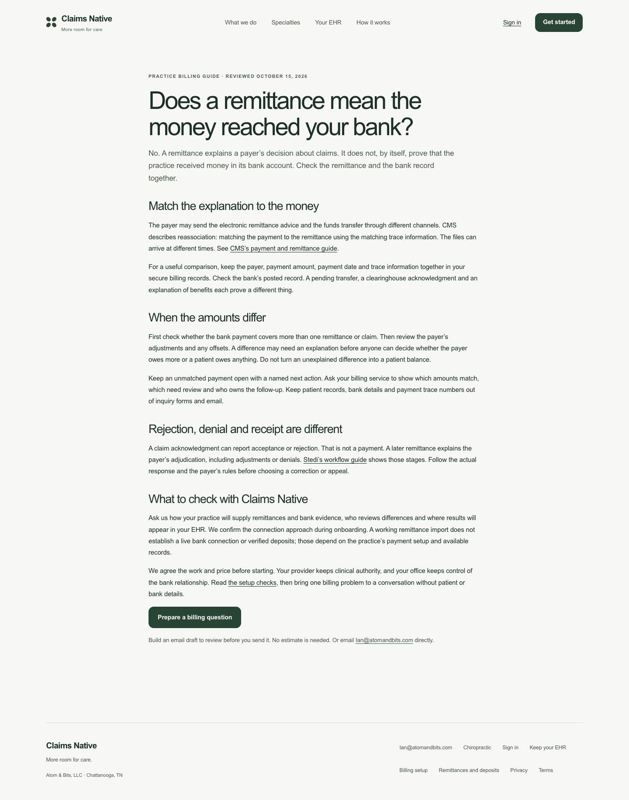
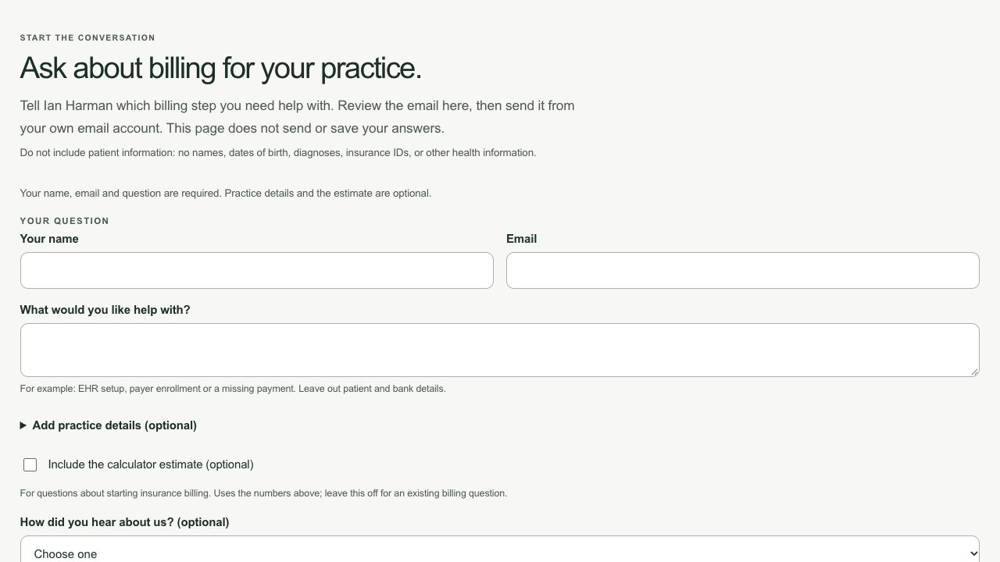
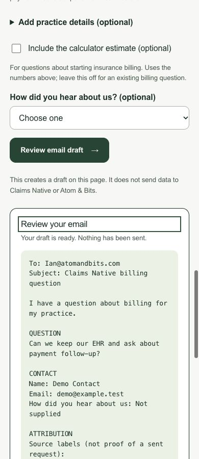

# Guide clarity and inquiry conversion review

October 16, 2026. Input: growth `c1558100a6562b8702ba81f271fde26a689166eb`; repaired source: `488da0d79e7e09dc578658ea5183f8acc3912108`. [Draft PR #55](https://github.com/ihint/atomandbitsweb/pull/55) remains based on positioning PR #54 at `e94a888`. Ian authorized review, repairs and a draft update; neither PR is authorized to merge or deploy. No human reviewer was needed.

The reader is a practice owner or manager deciding whether to ask about billing support. The goal is a useful answer followed by an accurate, low-effort question. Clearer conversion paths are a design judgment; no conversion lift is measured.

## Standards

[Independent report, verbatim](clarity-standards.md), [provenance](clarity-standards-provenance.json): three findings, worst P1. An enabled HTML form could fall back to GET when JavaScript failed. Drafts included untouched calculator examples. The setup guide assigned missing-response follow-up to the practice. The first two predate the growth base. The agent inspected all five fresh author screenshots, read source and ran in-memory Node checks. It did not run a browser.

## Spec

[Independent report, verbatim](clarity-spec.md), [provenance](clarity-spec-provenance.json): three P2 findings. Default estimates misstate existing-billing inquiries; nine fields block a first question; guide email buttons and the final handoff lack clear expectations and fallback instructions. The agent inspected all five fresh screenshots and ran synthetic draft checks. Reduced abandonment remains a hypothesis.

Six reported findings overlap on the default estimate, leaving five distinct issues. A [fresh independent closure](closure.md), with [provenance](closure-provenance.json), closed all five at `488da0d` and found no actionable Standards or Spec issue. It independently passed 30 Node tests and 10 scorecard tests. It did not rerun builds, images or browsers; those remain author execution.

## Repairs

| Finding | Change and proof |
|---|---|
| P1: script failure can expose answers in a URL | HTML disables the full inquiry fieldset and submit button. Initialization enables them only after the local handler is attached. Source/unit checks cover this boundary; browser JavaScript-disabled mode was not executed. The no-script email link remains available. |
| P2: unrequested revenue estimate | A normal inquiry uses a general billing question and omits the estimate. Checkbox selection or “Use this estimate” includes current calculator values. Unit and browser cases verify both paths and stale-draft removal. |
| P2: nine required fields | Only name, email and question are required. Practice details sit in an optional disclosure and blank answers are omitted. Native missing-field and invalid-email validation, a minimal question and optional EHR context passed in the local browser. |
| P2: unclear email handoff | Each guide now links to the on-page question. Text explains that it builds an unsent email draft, with a clearly named direct email alternative. The draft gives webmail copy instructions. No email client or send was opened. |
| P2: routine follow-up assigned to the practice | The setup guide now names the billing service as responsible for checking routes and following up missing responses. Practice authorization remains separate. |

The draft heading receives keyboard focus; Tab reaches the Open email link. Reduced-motion handling and edits that invalidate the draft have regression coverage. Script/style query versions change together so a future release does not pair the new disabled form with cached old JavaScript. The primary homepage positioning, prices, routes, consent and readiness limits are preserved. Collection still has no configured key.

## Captured flow

The before screenshots were captured in this audit run from the clean `c155810` preview: [EHR](before/01-keep-your-ehr.jpg), [setup](before/02-billing-setup.jpg), [payments](before/03-remittance-and-deposits.jpg), [inquiry entry](before/04-inquiry-start.jpg), [draft](before/05-draft.jpg). The author inspected each saved image before accepting it. [Baseline observations](before/observations.json) and its [build manifest](before/build-manifest.json) retain source identity. A stopped local server was restarted before capture; a later cached pre-change image was rejected and replaced after reload. A label locator missed Frequency; the visible combobox role passed. Neither issue is treated as a passing failed check.

1. **EHR guide — clear answer and next step.** Keeps the distinction between a file, login and direct connection. The new inquiry action names what happens and needs no email app first.

   

2. **Setup guide — clear ownership.** Keeps separate enrollment checks and gives routine missing-response follow-up to the billing service.

   

3. **Remittance guide — clear limits and next step.** Keeps bank receipt distinct from a payer explanation and offers the same on-page question path.

   

4. **Inquiry — three-field first question.** Practice context and estimate are optional. The calculator stays available, with a direct skip link for existing-billing questions. Desktop form and phone entry/form captures show the different paths.

   

   [Phone entry](after/06-phone-entry.jpg) · [Phone form](after/06-phone-form.jpg)

5. **Draft — accurate and visibly unsent.** The question comes first, optional context appears only when supplied, the estimate stays out unless chosen, and webmail instructions explain the final step. The phone draft is shown below; the [desktop full-flow capture](after/05-question-draft.jpg) retains the form and copy fallback together.

   

## Checks and limits

The [full author gate](software-checks.txt) passes 41 tests: 19 measurement, nine inquiry, two redirect, 10 scorecard and one manifest-mutation case. Production/preview builds, eight HTML pages, 151 local references, seven sitemap entries and asset hashes pass. The new inquiry suite fails seven of nine cases against the original source and passes all nine after repair; [baseline results](regression-baseline.json) retain the distinction.

Fresh [layout checks](after/layout-checks.json) cover all eight pages at 1440, 390 and 320 pixels: 24 checks with no horizontal overflow. Fresh [flow checks](after/flow-checks.json) cover missing fields, invalid email, a minimal question, draft/Tab focus, optional EHR context, estimate opt-in and stale-draft clearing, plus a phone inquiry. Source/preview bytes are bound to clean `488da0d` in the [manifest](after/build-manifest.json), with all 27 source hashes and 20 served-asset hashes checked before accepting the results. Screenshot hashes are recorded separately. The later evidence commit changes no runtime/build/test/workflow input.

This review did not independently rerun the earlier canonical-host intercepted event fixture. The updated fixture remains reproducible; 19 unit cases freshly check the unchanged consent/privacy rules and new fixed guide CTA. Browser execution used localhost with collection disabled. JavaScript-disabled mode, full screen-reader/accessibility compliance, live email-app behavior, production ingestion, indexing, legal/clinical acceptance, customers and conversion lift remain unproved. No new account, spend, outside message, merge or deployment occurred. Keep both PRs unmerged and undeployed.
